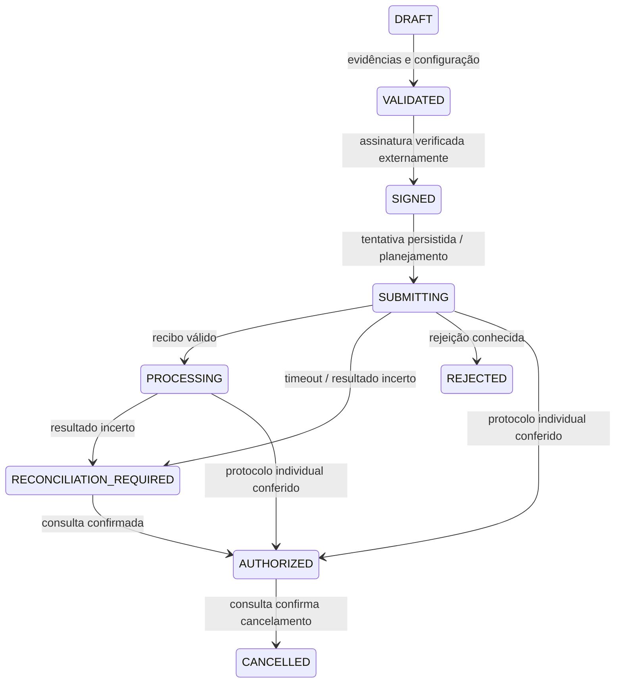

# Fundação do emissor Brufap

Biblioteca interna, sem dependências e sem rede, para preparação futura de NF-e 55 e NFC-e 65. **Não é um emissor homologado. Não monta, assina ou transmite XML; não calcula tributos.** Nenhum certificado, senha, CSC, nota real ou dado privado está nas fixtures.

Executar: `npm test --prefix packages/fiscal-core`.

## Entregue

- Validação estrutural da identidade: CNPJ, modelo, ambiente, UF, série, número, data/hora com fuso, forma de emissão e código numérico.
- Chave de 44 posições com DV módulo 11. Compatibilidade numérica e alfanumérica; caracteres fora das posições permitidas são recusados. CNPJ é recebido sem máscara, em maiúsculas, como string.
- Código numérico aleatório de oito posições gerado com Web Crypto, sem viés de módulo.
- Gates separados para configuração e transmissão. `configurationReady` verifica metadados; `canTransmit` é sempre `false` e informa `TRANSPORT_NOT_IMPLEMENTED`.
- Transições imutáveis, revisão esperada, digest do conteúdo, vínculo da resposta com requisição/ambiente/chave, tratamento conservador de respostas incertas e repetição de operação.

Este primeiro caminho de preparação limita-se a empresa com CNPJ, SP, aplicação própria, série 000–889 e emissão normal. Outros estados, emissão por CPF, séries especiais e contingência falham explicitamente no gate ou na identidade. Reconhecer a estrutura de uma chave não comprova existência, autorização ou regularidade da nota/CNPJ.

## Contrato de integração

`createEmission({ id, identity })` recebe `cUF`, `cnpj`, `model`, `environment`, `series`, `number`, `issuedAt`, `cNF` e `tpEmis`. Não cria número fiscal automaticamente. A data conserva o mês do fuso informado, inclusive em virada de mês UTC. A chave não contém ambiente; o controle interno sempre separa produção e homologação.

`validateEmission` exige configuração pronta, digest SHA-256 do documento, declaração de validação de schema e referência de revisão tributária. `attachSignature` exige digest do XML assinado e confirmação de verificação. **Esses campos são atestações produzidas por componentes confiáveis futuros; a biblioteca não executa XSD, ICP-Brasil, assinatura ou revisão tributária. Nunca aceitar essas atestações diretamente do navegador.**

`beginSubmission` apenas planeja a transição para `SUBMITTING`; retorna `planned: true` na primeira passagem e `TRANSPORT_NOT_IMPLEMENTED`. Não contém adaptador de rede. A repetição em estado pendente ou final retorna `planned: false`; conteúdo assinado diferente é recusado. Configuração e validade do certificado são novamente verificadas antes dessa primeira transição.

O futuro repositório deve, **na mesma transação**, reservar a numeração, aplicar unicidade por `identityKey`, atualizar com `WHERE revision = expectedRevision` e persistir a tentativa antes de chamar qualquer adaptador. Uma linha afetada é requisito para prosseguir. É obrigatório manter lease/controle de concorrência do emissor e arquivar XML/protocolo de forma privada. Esta biblioteca pura não fornece exclusão mútua distribuída nem substitui restrições SQL. O `identityKey` é deliberadamente conservador: mudar data, cNF ou tpEmis não libera outra nota com a mesma empresa/modelo/série/número/ambiente.

`applySefazResponse` recebe um resultado **normalizado por adaptador confiável**, com `requestId`, `environment`, `source` (`authorization`, `receipt`, `protocol`), `verified`, `evidenceDigest` e `cStat`. O adaptador validará origem TLS, XML/XSD e contexto da consulta; guardará a resposta integral em armazenamento privado; não repassará `xMotivo` ou XML ao registro desta máquina.

Para resultado individual, `protocol` contém `accessKey`, `environment`, `cStat`, `number` e `receivedAt`. Nas respostas de autorização/recibo, o envelope processado usa `cStat=104`; o resultado individual define a nota. Na consulta de protocolo, o adaptador normaliza o estado final inclusive eventos, mantendo o código do resultado individual igual ao código do envelope normalizado. Isso **não é um parser dos envelopes XML SEFAZ**. São aceitos protocolos numéricos de 15 ou 17 posições para compatibilidade histórica/atual. A persistência separa `authorizationProtocol`/`authorizationReceivedAt`/`authorizationEvidenceDigest` de `cancellationProtocol`/`cancellationReceivedAt`/`cancellationEvidenceDigest`: cancelar nunca apaga a evidência de autorização.

## Estados e reconciliação

- `103/105` mantém processamento com recibo; `104` sozinho não autoriza a nota.
- Timeout, `204/539` (duplicidade), `106/217` (não localizado) e códigos não classificados permanecem em reconciliação. O próximo passo é consultar o recibo, se existente, e/ou a mesma chave. **Não há reenvio automático, mudança de chave nem liberação de numeração nesse caminho.** Trata-se de política conservadora de produto; um futuro reenvio exato dependerá de rotina própria com evidências e controle de tentativas.
- `100/150` requer protocolo individual, chave, ambiente e data coerentes. Estado autorizado não regride por consulta incompleta. Repetição do mesmo protocolo é idempotente.
- Cancelamento é apenas reconciliado por consulta; não é solicitado por esta biblioteca. Denegação legada pode ser reconhecida na consulta histórica e conserva o bloqueio da numeração. A revisão de nota rejeitada ainda precisa de fluxo próprio; não é reenviada diretamente.

## Configuração pendente para a empresa

Regime tributário confirmado e revisão das operações; IE validada cadastralmente; A1 verificado e armazenado em cofre; credenciamento por modelo/ambiente; seleção explícita do perfil QR da NFC-e, com CSC por ambiente no caminho legado; perfil XSD/Notas Técnicas vigente; evidência de testes reais em homologação por modelo. `secretRef` aponta para um cofre futuro e não contém a credencial. O gate A1 é uma escolha técnica desta implementação, não uma afirmação de exclusividade legal de A1. A evidência de homologação antes de habilitar produção também é política de qualidade do Brufap.

Os pacotes irmãos [`fiscal-xml`](../fiscal-xml/README.md) e [`fiscal-schema`](../fiscal-schema/README.md) já fornecem assinatura/verificação offline, suplemento QR v3 online SP/homologação e cinco schemas oficiais com integridade fixada. Ainda não estão conectados a esta máquina de estados por uma orquestração confiável. O gate aceita `config.nfceQrProfile = NFCE_SP_HOMOLOGATION_QR_V3` somente para NFC-e 65, SP, homologação e emissão normal. Esse perfil compartilha as constantes com o suplemento XML e dispensa CSC, de acordo com o formato QR v3. Seleção desconhecida, nula ou fora desse contexto bloqueia; não há fallback silencioso. Sem seleção explícita, a exigência legada de CSC é preservada. Isso não atesta aceitação pela SEFAZ nem credenciamento: certificado, revisão tributária/XSD e credenciamento continuam obrigatórios, e `canTransmit` permanece falso. Produção e contingência não são ampliadas.

O [gerador inicial de negócio](../../docs/integrations/fiscal-business-builder.md) resolve um recorte explícito de itens, totais e pagamentos, ainda sem integração operacional. Faltam determinação tributária completa e revisão de vigência, complementação persistida, TLS mútuo/SOAP operacional, DANFE/representação gráfica do QR, adaptador SEFAZ, persistência transacional fiscal, eventos, contingência e testes efetivos com a SEFAZ. Os testes sintéticos **não** representam homologação fiscal.

## Fontes oficiais verificadas em 15/10/2026

1. [MOC 7.0 — Visão Geral, CONFAZ](https://www.confaz.fazenda.gov.br/legislacao/arquivo-manuais/moc7-visao-geral.pdf), §§2.2.6–2.2.8 e 5.1–5.4: composição/DV da chave, chave natural, séries e consultas. O vetor de DV do manual resulta em 5. A implementação usa chave interna mais restritiva para impedir repetição operacional. O PDF é base histórica e precisa ser complementado por Notas Técnicas vigentes.
2. [MOC Anexo I — Portal NF-e](https://www.nfe.fazenda.gov.br/PORTAl/exibirArquivo.aspx?conteudo=J%2BI%2Bv4eN00E%3D): estrutura dos modelos 55/65 e significados básicos dos retornos. Consulta disponível por indexação oficial; abertura direta apresentou redirecionamento no ambiente de pesquisa. Não foi incorporado um catálogo exaustivo de rejeições.
3. [NT Conjunta 2025.001 — CNPJ alfanumérico](https://www.nfe.fazenda.gov.br/Portal/exibirArquivo.aspx?conteudo=5ZkvIZt10mQ%3D), §5: permite letras nas 12 primeiras posições do CNPJ da chave e mantém 44 posições. Trecho do algoritmo: “trocando todos os caracteres (44) que compõe a chave (números e letras) pelos números correspondentes da tabela ASCII subtraindo 48”. O Anexo II de código aplica pesos por caractere, sem concatenar os valores ASCII em novos dígitos.
4. [Receita Federal — cálculo do DV do CNPJ](https://www.gov.br/receitafederal/pt-br/centrais-de-conteudo/publicacoes/documentos-tecnicos/cnpj/manual-dv-cnpj.pdf): vetor oficial `12ABC34501DE35`, com dois DVs; [projeto CNPJ alfanumérico](https://www.gov.br/receitafederal/pt-br/acesso-a-informacao/acoes-e-programas/programas-e-atividades/cnpj-alfanumerico) confirma preservação dos CNPJs numéricos existentes.
5. [SEFAZ-SP — NFC-e](https://portal.fazenda.sp.gov.br/servicos/nfce/), aviso de 09/09/2026: “o ambiente de produção passará a adotar o número do protocolo de 17 posições”; a data anunciada é 05/10/2026. A página também informa CSC após credenciamento e autorização síncrona. Não inferimos dessa publicação que a empresa já esteja credenciada.
6. [SEFAZ-SP — credenciamento NF-e](https://portal.fazenda.sp.gov.br/servicos/nfe/Paginas/PaginaGuiaDoUsuario.aspx): acesso por certificado e credenciamento também para ambiente de testes. Certificado pode identificar estabelecimento da mesma empresa; por isso o gate confere raiz do CNPJ, além da validade declarada.
7. [NT 2024.001 — CRT MEI](https://www.nfe.fazenda.gov.br/Portal/exibirArquivo.aspx?conteudo=kIiniiSkpKc%3D): inclui CRT 4. O gate aceita CRT 1–4, sempre confirmado, sem escolher enquadramento nem calcular imposto.
8. [Portal NF-e — Notas Técnicas](https://www.nfe.fazenda.gov.br/portal/listaConteudo.aspx?tipoConteudo=04BIflQt1aY%3D): inclui alterações recentes de CNPJ, RTC, QR Code e autorização síncrona. Não fixamos o MOC antigo como schema completo atual nem afirmamos implementação da RTC; um perfil vigente revisado é dependência explícita.

Os testes usam o vetor público de DV do MOC, o vetor público de CNPJ da Receita e documentos fictícios. Cobrem limite de série/número, datas inválidas e virada de mês, CNPJ alfanumérico, tamper de chave, configuração incompleta, ambiente/CSC, concorrência por revisão, repetição, timeout, duplicidade, recibo, rejeição, autorização e cancelamento reconciliado.

## Revisão QR em 16/10/2026

A [NT 2025.001 v1.03](https://www.nfe.fazenda.gov.br/Portal/exibirArquivo.aspx?conteudo=NvuzQGYd6E8%3D), seção 02.1, define QR v3 sem controle de CSC. A adoção por pessoa jurídica é opcional; isso não extingue o formato anterior. A consulta pelo índice oficial forneceu o texto, enquanto a abertura direta do PDF apresentou redirecionamento. Os [endereços oficiais da SEFAZ-SP](https://portal.fazenda.sp.gov.br/servicos/nfce/Paginas/WebServices.aspx) confirmaram `/qrcode` e `/consulta` em homologação. O aviso geral da página NFC-e sobre obtenção de CSC não foi tratado como comprovação de requisito do formato v3 nem de credenciamento desta empresa. A mudança é uma seleção de formato offline, não um ensaio de aceitação. Nenhuma nova consulta com A1 ou transmissão foi feita nesta revisão.
